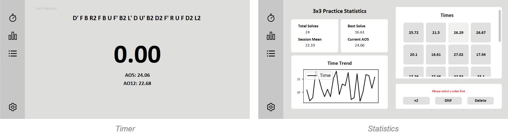
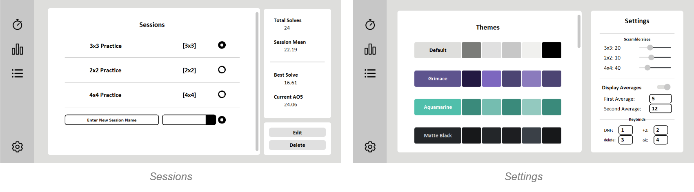

# Rubiks Cube Timer

<br>

<p align="center">
  A rubiks cube timer I made for a high school project in 2023.<br>
  Built with Python while learning how to make desktop apps.
</p>

<br>





## Features

- Scrambles for 2x2, 3x3 and 4x4.
- Separate practice sessions with saved solve history.
- Averages, best times and a graph of your solves.
- +2 and DNF corrections.
- Colour themes and custom keybinds.

## Running locally

Install [Python](https://www.python.org/downloads/), then download or clone this project. Open a terminal in the project folder and run:

```bash
python -m pip install customtkinter pandas matplotlib pillow
python "Cube timer.py"
```

Press and release Space to start, then press it again to stop. Solves and settings are saved locally in CSV files.
